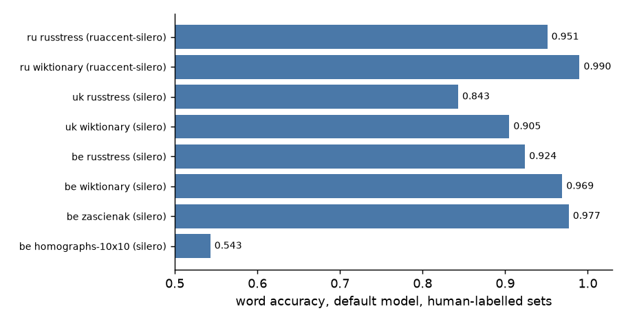

# stressonnx documentation

<!-- agent-hint: start at agents.md for layout, test command and pitfalls -->

stressonnx puts word-stress marks into text for text-to-speech front ends. It supports 26 language tags. It runs on `onnxruntime` and `numpy` only, with no torch at runtime. The output is the combining acute accent (U+0301) after the stressed vowel, or the `+` notation before it.

The 23 languages other than ru, uk and be have no human-labelled test set. Their scores are in [`benchmarks/RESULTS.md`](../benchmarks/RESULTS.md).

## Pages

| Page | Read it to |
| :--- | :--- |
| [Supported languages and models](supported-languages.md) | find the model for a language and its measured accuracy |
| [Usage](usage.md) | call `stress`, `analyze`, `stress_batch`, and choose a notation |
| [Offline use and failure behaviour](offline-and-errors.md) | run without a network, and handle download and load errors |
| [Language guide](languages.md) | learn why each language needs stress marks, with citations |
| [Model reference](models.md) | learn how each backend works and where it fails |
| [Architecture](architecture.md) | learn the package layout, registry, data flow and cache |
| [Add a language](adding-a-language.md) | add a language file and its sources |
| [Credits and licences](credits.md) | find the licence of each model and data set |
| [Agent hints](agents.md) | work on this repo as a coding agent |
